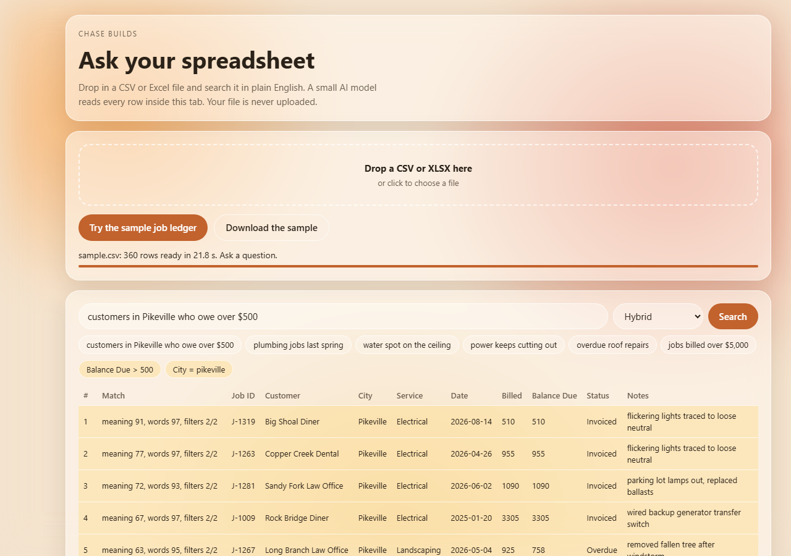

# ask-your-spreadsheet

[](https://github.com/chasebuilds/ask-your-spreadsheet/actions/workflows/ci.yml) [](https://github.com/chasebuilds/ask-your-spreadsheet/actions/workflows/pages.yml) [](LICENSE)

Search a spreadsheet in plain English, like "customers in Pikeville who owe over $500" or "plumbing jobs last spring", with an AI model that runs inside your browser tab.

**[Live demo: try it in your browser](https://chasebuilds.github.io/ask-your-spreadsheet/)**. Drop in your own CSV or Excel file, or load the bundled sample job ledger with one click.

[](https://chasebuilds.github.io/ask-your-spreadsheet/)

Built for small offices, bookkeepers and real estate teams who keep their records in spreadsheets and know roughly what they are looking for but not which words the row uses. A note that says "ceiling stain from roof leak" comes up for "water spot on the ceiling", and "who owes over $500 in Pikeville" turns into real filters on the City and Balance Due columns.

## Measured result

A seeded synthetic job ledger for a small trades office (360 rows, every business, place-name pairing and amount invented) and 45 labeled questions, scored by `npm run bench`. The correct rows for each question are defined by a rule over the sheet's own columns (for example `City = Pikeville and Balance Due > 500`), so labels cannot drift from the data. R@5 is the share of correct rows in the top 5 (out of at most 5); MRR is 1 over the rank of the first correct row.

<!-- benchmark:start -->
| Query set | Queries | Keyword R@5 | Keyword MRR | Semantic R@5 | Semantic MRR | Hybrid R@5 | Hybrid MRR |
|---|---:|---:|---:|---:|---:|---:|---:|
| Meaning (paraphrased notes) | 24 | 51.7% | 0.614 | 70.8% | 0.864 | 77.5% | 0.910 |
| Filters (place, amount, date) | 13 | 26.2% | 0.385 | 25.0% | 0.405 | 100.0% | 1.000 |
| Mixed | 8 | 44.6% | 0.426 | 61.9% | 0.678 | 95.0% | 0.817 |
| **All** | 45 | 43.0% | 0.515 | 56.0% | 0.698 | **87.1%** | 0.919 |

360 synthetic rows, 45 labeled queries, model `Xenova/all-MiniLM-L6-v2` (q8). Embedding the sheet took 5.9 s in Node on the machine that ran it.
<!-- benchmark:end -->

What the numbers say: meaning search alone beats keyword search on paraphrased questions, but neither can do "over $500" or "last spring", because a sentence model does not compare numbers or dates. The hybrid pass reads those out of the question and turns them into column filters. Read the filter row with care: the parser is general (it finds money, date and low-variety text columns in any sheet), but the questions were written by the same hand that wrote the parser, so 100% there means "the phrasings it was built for work", not "any phrasing works". The weakest spots are short paraphrases that share no words with the note ("leaky tap" against "dripping faucet") questions that need a category the sheet does not have ("water leaks" spans plumbing and roofing), and a few where the keyword half pulls hybrid below meaning-only: "grass cutting" also matches the customer name "Grassy Ridge", and "raking leaves in autumn" reads "autumn" as a date filter. On 5 of the 45 questions hybrid scores lower than meaning-only; switch the mode to Meaning only when that happens. Per-question scores are in [`bench/results.json`](bench/results.json).

## How it works

1. **Read the file.** CSV through Papa Parse, Excel through SheetJS, first sheet only, up to 5,000 rows.
2. **Embed each row.** Every row becomes one line of `column: value` text and goes through [all-MiniLM-L6-v2](https://huggingface.co/Xenova/all-MiniLM-L6-v2) (8-bit, about 23 MB) with [transformers.js](https://github.com/huggingface/transformers.js). The 360-row sample takes a few seconds on a laptop.
3. **Profile the columns.** Columns where every value is a number, a date, or one of a few repeated values (city, service, status) are noted.
4. **Read the question.** The same model embeds the question. A small parser pulls out comparisons ("over $500", "between 300 and 600", "under 2k"), values that appear in a repeated-value column ("Pikeville", "plumbing", "overdue"), and dates ("January 2026", "summer 2025", "last spring", counted back from the newest date in the sheet). Words like "owe" or "balance" point the amount at the balance column; "billed" or a bare amount points at the charge column.
5. **Rank.** Hybrid score = 0.65 x meaning similarity + 0.35 x BM25 keyword score, plus a bonus for each parsed filter the row passes, so rows that meet every filter come first. The filters found are shown as chips, and each result shows its meaning, keyword and filter scores, so you can see why it ranked where it did.

The Meaning only and Keywords only modes in the page are the two baselines from the table.

## Privacy

Nothing you load leaves the browser. The page is static files on GitHub Pages; the only network request after it loads is the one-time model download from the Hugging Face CDN, which is cached by the browser. There is no server, no analytics and no upload.

## Run it locally

```
npm install
npm run dev          # http://localhost:5173/ask-your-spreadsheet/
npm test             # unit tests (parser, BM25, ranking, metrics, label sanity)
npm run smoke        # builds, serves and drives the page in headless Chromium
npm run bench        # rebuilds the table above (downloads the model once)
npm run sample       # regenerates public/sample.csv from its seed
```

Run the smoke test against the live site with `BASE_URL=https://chasebuilds.github.io/ask-your-spreadsheet/ npm run smoke`. It waits for the page's own ready signal (`body[data-ready="true"]`) rather than sleeping.

## Limits

- One sheet at a time, first 5,000 rows. Very wide rows are cut by the model's input length (256 word pieces).
- The parser is English-only and rule-based. It handles "over", "under", "at least", "between", "k" amounts, month names, seasons, years, "last" and "this". It does not handle "top 10", "average", sorting or sums.
- The model is small and general. It knows "faucet" and "tap" are close; it does not know your office's shorthand.

## License

MIT, Chase Builds.

## More from Chase Builds

- **[pii-redactor](https://github.com/chasebuilds/pii-redactor)**: Finds and masks names, emails, phone numbers and other personal information in CSV, Excel, text and PDF files. ([live demo](https://chasebuilds.github.io/pii-redactor/))
- **[pdf-qa-local](https://github.com/chasebuilds/pdf-qa-local)**: Ask questions about your PDFs with AI that runs on your own computer, so documents never leave the office.
- **[lead-list-qa](https://github.com/chasebuilds/lead-list-qa)**: Offline quality checks for B2B contact lists. ([live demo](https://chasebuilds.github.io/lead-list-qa/))

[All projects, sorted by industry](https://github.com/chasebuilds) · [chasebuilds.github.io](https://chasebuilds.github.io)
